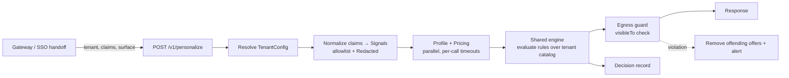

# RFC-001: Serving Switchback Through the Personalization Service

| | |
|---|---|
| **Author** | Ronan McCoy |
| **Squad** | Insiders |
| **Status** | Proposed |
| **Date** | 2026-10-19 |


## 0. Summary

Switchback's users are served by the existing personalization service through one code path: a shared engine that never branches on tenant, driven by per-tenant config. Isolation is enforced in independent layers, ending in an egress guard that checks every outgoing offer against the request's tenant, and a CI test fails on any cross-tenant offer for every registered tenant. When a dependency is slow or down, offers that need the missing data fail closed: we never show a rate the pricing service didn't return. Tenant 0 moves onto the new engine first, proven by shadow traffic, so Switchback launches as a second config on an engine already proven in production.

## 1. Context & Goals

The service decides which offers and content a logged-in member sees, and today serves only tenant 0. Switchback, our first embedded partner, sends users via SSO with sensitive signals (earnings, tenure) and has an exclusive rate tier that must never reach tenant 0, and vice versa.

**Goals**
- G1: One code path for both tenants. Adding a tenant is config, not an engine change.
- G2: Cross-tenant leakage is hard to cause, fails CI automatically, and is detectable and recoverable in production.
- G3: No behavior or latency change for tenant 0 during or after rollout.
- G4: p99 < 200ms at 5k RPS, with a safe answer when a dependency is down.
- G5: Every decision can be explained from its record alone.

**Out of Scope**
- Self-serve partner onboarding.
- Extensive rules engine.
- Per-tenant infrastructure.

## 2. Assumptions

- **A1:** The existing personalization service is fictional. The prototype represents an extension of the service after the stage 0 refactor with tenant 0's current offers and thresholds moved into a configuration structure.
- **A2:** The SSO token is verified upstream, so the service does not re-validate it and always receives trusted claims.
- **A3:** In production the gateway sets `tenant` from the token or route, never the browser. Switchback traffic always comes through a route that sets it. The current prototype takes `tenant` from the request body for simplicity.
- **A4:** Offers and rule parameters change at deploy time, not per request.
- **A5:** Profile and pricing are shared services that accept a tenant parameter.
- **A6:** Switchback's contract lets sensitive signals inform eligibility but not be stored raw or logged.
- **A7:** Decision-record retention is a contract decision; Section 7's numbers are proposals.
- **A8:** The prototype uses in-memory fakes for profile and pricing, with injectable failures (`FAKE_PROFILE` / `FAKE_PRICING` for demos).

## 3. Tenant-Aware Personalization (brief Q1)

### 3.1 Request flow



### 3.2 The seam: rule types vs. rule parameters

The engine owns *how* a decision is made; each tenant's config owns *what* it offers and *which thresholds* apply.

| Shared engine (code, tested once) | Tenant config (data, reviewed per tenant) |
|---|---|
| Rule *types*: `minTenureMonths`, `minMonthlyEarningsUsd`, `minMemberDays` | Which rules each offer uses, and their parameters |
| Signal reading and redaction | Which SSO claims map to which signals; which are sensitive |
| Dependency calls, timeouts, fallback mechanics | Timeouts within the shared budget; fallback offers |
| Egress guard, validation, decision records | Offers, with `kind` and `visibleTo` |

**The engine never branches on tenant ID.** Switchback's exclusive rate needs 6+ months of tenure: the engine has one `minTenureMonths` rule type, and Switchback's config uses it with `{ months: 6 }`. Nothing in the engine knows Switchback exists.

**Why here:**
- **Not lower (per-tenant code):** each tenant becomes its own code path, with its own bugs and its own chance to mishandle sensitive data. Isolation would have to be re-proven per tenant.
- **Not higher (a configurable rules language):** that would be the out-of-scope self-serve platform, and it moves untested logic into data. Config holds values, never logic.
- **At this level,** the risky parts live in one place with one test suite, and onboarding a tenant is a data diff a reviewer can read in minutes.

When a tenant needs behavior no rule type supports, we add a new rule type to the engine, available to every tenant. Never a tenant branch.

### 3.3 Key types (from `src/core/types.ts`, abridged)

```ts
interface TenantConfig {
  id: TenantId;                                     // a string: new tenants need no core change
  version: string;                                  // stamped on every decision record
  claimSignals: Partial<Record<SignalKey, string>>; // unmapped claims are never read
  profileSignals: readonly SignalKey[];             // fetched only when an offer needs them
  sensitiveSignals: readonly SignalKey[];           // wrapped in Redacted<T>; never logged raw
  offers: readonly OfferConfig[];                   // each with kind, visibleTo, rules, requiresPricing
  fallbackOfferIds: readonly string[];
  timeouts: { profileMs: number; pricingMs: number };
}
```

## 4. Isolation & Data Boundaries (brief Q2)

### 4.1 Prevention

| Layer | Mechanism | Catches |
|---|---|---|
| 1. Tenant resolution | `tenant` set by the gateway from verified context (A3) | Spoofed tenant |
| 2. Partition at load | Engine receives only the requesting tenant's config | Logic bugs selecting foreign offers |
| 3. Claim allowlist + `Redacted<T>` | Unmapped claims ignored; sensitive values serialize as `[redacted]` | Spoofed claims, accidental logging |
| 4. Egress guard | Every outgoing offer must list the *request's* tenant in `visibleTo`, whichever config was loaded | Wrong config resolved, cache-key bugs |
| 5. Startup validation | Exclusives visible to exactly one tenant; offer IDs unique across tenants; every rule's signal has a source; fallbacks need no dependencies | Bad config, before it serves traffic |

Each layer is simple, and they fail independently, so a breach needs several unrelated mistakes at once.

### 4.2 Detection

- **CI:** a property-based test runs random claims, surfaces and outages against every tenant in the registry, and fails on any foreign offer. A new tenant is covered automatically.
- **Production:** alert on any egress-guard violation; a synthetic canary sends cross-tenant requests every minute; New Relic log obfuscation on Switchback claim names masks anything that slips past `Redacted`.

### 4.3 Recovery

The guard has already removed the offending offers, so users don't see the leak. Then:
1. Flip the tenant's kill switch to fallback-only, with no deploy.
2. Scope the impact from decision records: which `configVersion`, users and time window.
3. Revert, and add a test that reproduces the breach.
4. Notify the partner per the contract, with the scope from step 2.
5. Re-enable through the normal ramp.

## 5. Extending, Not Rewriting (brief Q3)

**Change in place**
- Add `tenant` to the request, defaulting to `tenant0` so existing callers don't change. The default is transitional and only safe because of A3; it becomes required once tenant 0 callers send it.
- Move tenant 0's offers and thresholds, unchanged, into `tenant0` config; thread config through the engine.
- Add `kind` and `visibleTo` to offers, the egress guard, startup validation, and a decision record per request.

**Wrap behind an adapter**
- Profile and pricing clients: timeouts, tenant parameter, fakes for tests.
- SSO claims → normalized signals, so a renamed Switchback claim is a config change only.
- Decision-record output: a structured log today; Firehose is added at the logging layer, not the engine.

**Leave alone:** tenant 0's auth path and the rule-evaluation internals. Both work, neither blocks Switchback, and the shadow diffs below only mean something if the move to config is the *only* change.

### 5.1 Rollout plan

**Tenant 0 moves onto the new engine before Switchback is turned on.** Tenant 0 is the only tenant with a known-good reference (the existing path) to diff against; Switchback has none. So we prove the engine on tenant 0 under shadow traffic, with no user impact, and Switchback then launches as a second config on a proven engine. The reverse order only looks safer: it leaves two engines in one service and pushes tenant 0's migration, and its risk, to later (see Section 9).

| Stage | What happens | Exit criteria | Roll back if |
|---|---|---|---|
| 0. Refactor | Tenant 0 moves to config behind a flag (initially set to `off`) | Fixture tests: old and new paths match | Any fixture diff |
| 1. Shadow tenant 0 | Both paths run; old result served, new result diffed | Diff < 0.1% for 7 days, all diffs explained; p99 in budget | n/a, nothing served |
| 2. Flip tenant 0 | 1% → 10% → 50% → 100%, old path still deployed | SLOs hold 24h per step | p99 +10ms, errors or diffs spike |
| 3. Switchback internal | Internal and partner test accounts only | Claims map correctly; zero guard violations; partner sign-off | Any violation or raw sensitive value in logs |
| 4. Switchback ramp | 5% → 25% → 100% | SLOs hold; kill switch tested in prod | Violation or SLO breach → Switchback kill switch |
| 5. Clean up | Remove the old path and shadow harness | 2 weeks stable | n/a |

Flags are per tenant, so rolling back Switchback never touches tenant 0. In shadow mode, each dependency is called once and its response feeds both paths (no extra load, and clean diffs), and the new path runs off the response path so it can't affect tenant 0's latency. Diffs target parity first; fixes to old behavior ship separately.

## 6. Degraded Mode & Performance (brief Q4)

### 6.1 Latency budget (p99 < 200ms)

| Step | Budget |
|---|---|
| Config + signals (in memory) | ~5ms |
| Profile ∥ pricing, in parallel | ≤ 80ms (hard per-call timeouts; validation caps them at 150ms) |
| Rules + guard | ~5ms |
| Network, GC, serialization | remainder |

At 5k RPS: nothing on the request path hits a database, the service is stateless and scales horizontally on ECS, connections to dependencies are pooled, and decision records are logged asynchronously. About 500 requests are in flight at once, mostly waiting on dependencies, so pricing's capacity is the real constraint. A load test confirms sizing before the Switchback ramp.

### 6.2 What it returns when a dependency fails

| Profile | Pricing | Response |
|---|---|---|
| ✅ | ✅ | Full personalization |
| ❌ | ✅ | Offers needing profile data fail closed; the rest are shown |
| any | ❌ | Offers needing a price are dropped, so **no exclusive rate is ever shown without a real price**; other eligible offers are shown |
| — | — | Nothing eligible → the tenant's fallback (baseline, no pricing, no rules) |

Calls are made only when a candidate offer needs them (Switchback never calls profile). Degraded responses carry `degraded: true`, with the reasons in the decision record.

**Deferred:** a circuit breaker per dependency, and a short-TTL pricing cache. The cache key must include the tenant, and whether a slightly stale rate may be shown is a compliance question.

## 7. Explainable Decisions

Each request emits one record: `decisionId`, `timestamp`, `tenant`, `surface`, `userId`, `configVersion`, `degraded` + `degradedReasons`, `fallbackUsed`, each dependency's status and latency, and per offer `{ offerId, kind, shown, reasons[] }`. Reasons record the threshold and outcome (`tenureMonths >= 6: fail`), never the value. `decisionId` is returned in the response, so support can go from a complaint straight to the record.

**Where it lands:** a structured log to New Relic, kept **30 days** for support and debugging; and Firehose to S3, partitioned by tenant and date, kept **1 year** for audit and disputes (queryable with Athena, and exportable or deletable per partner). Both periods are pending Switchback's contract (A7).

## 8. Deferred

- Self-serve onboarding and per-tenant infrastructure.
- Config service with its own review workflow.
- Designed here but not in the prototype: kill switch, shadow-diff harness, real dependency clients, circuit breaker, pricing cache, load test, per-tenant rate limits.

## 9. Alternatives Considered

| Option | Why not |
|---|---|
| Fork the service for Switchback | Ruled out by leadership; two codebases drift |
| Per-tenant code modules | Tenant logic spreads through the engine; every tenant is a code change |
| Separate deployment per tenant | Strong isolation, but double the operating cost; premature for one partner |
| Switchback first, migrate tenant 0 later | Two engines in one service; defers tenant 0's risk instead of removing it. **I'd choose it only if** Switchback's date can't move, with tenant 0's migration scheduled and owned |

## 10. Risks & Open Questions

- Can the gateway guarantee `tenant` on every Switchback request (A3)? The transitional default depends on it.
- Who approves tenant config changes, and what are Switchback's retention limits?
- Does pricing return tenant-specific rates, or do we map tiers ourselves?
- A renamed Switchback claim silently disables their exclusive offer (safe, but wrong). Mitigation: alert on the `signal unavailable` rate per tenant.
